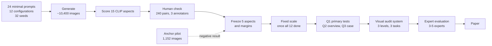

# Paper brief for co-authors

**Working title:** *Visual Auditing of Appearance Defaults in Text-to-Image Models*
**Target:** IEEE Computer Graphics and Applications (CG&A), regular article, submission mid-November 2026
**State:** 2026-10-13. Details: `RESEARCH_PROPOSAL.md` (v2.1), `PLAN.md`, `STATUS.md`.

---

## 1. In one paragraph
When a prompt says only "a kitchen", the text-to-image model decides everything else: lighting, framing, palette, medium. We call these decisions **appearance defaults**. Model developers and evaluators constantly swap models and settings (guidance strength, distillation, a new checkpoint), and every swap silently changes those defaults. A diversity score can say that outputs became "less diverse", but not **what** changed. The outputs may now settle **somewhere else** (*displacement*) or settle **more tightly in the same place** (*concentration*), and the answer may hold for some subjects and reverse for others. We present a **visual audit method** that answers these questions for many model configurations at once, on human-validated appearance axes, with every reading traceable to the images. We demonstrate it on 12 open configurations and 24 everyday subjects.

## 2. Background
- **The phenomenon.** Newer and faster models make the same unspecified decision almost every time. In our pilot, Vendi diversity for 16 images of one minimal prompt drops from 7.45 (SD 1.5) to 3.47 (SDXL-Turbo) to 2.79 (FLUX.2 klein). Within one model, raising guidance from 1 to 4 drops it from 5.95 to 2.32.
- **What is already known**, used only as background:
  - Diversity falls as models improve (DIMCIM, GRADE).
  - Guidance reduces diversity (CFG literature; stage-wise CFG analysis, ICLR 2026).
  - Distilled replacements shift attribute distributions (DefaultShift, 2026, our closest work).
  - Differences between image sets can be described automatically (VisDiff, CompCon).
- **What is missing.** Existing tools report *how much* outputs converge, or list *which* attributes differ, for one model or one pair. None lets an evaluator see, across many configurations at once:
  1. whether a change **displaces** or **concentrates** each appearance attribute;
  2. whether a pooled conclusion **holds for every subject**;
  3. whether the automatic measurement itself **can be trusted**, by checking the images.

## 3. Research questions
**Main question.** For a fixed set of minimal prompts and declared model configurations, which differences in appearance are displacements, which are concentrations, and which change from subject to subject, and how can an evaluator verify each in the images?

| | Question | Data | Kind of claim |
|---|---|---|---|
| **Q1 (primary)** | Does raising guidance displace appearance, concentrate it, or both? Is the answer the same in two model families? | klein-base 4B, CFG 1 → 4; Qwen-Image-2512, CFG 1 → 4. Only guidance changes; same seeds | Within-model intervention; 20 pre-registered tests |
| **Q2** | Where do the 12 configurations settle at their recommended settings, how far apart are they, and do the differences persist across subjects? | All 12 configurations × 24 subjects | Descriptive; no causal attribution to family or scale |
| **Q3 (case)** | What does a distillation package change? | klein-base 4B → klein 4B (steps 50 → 4 and a new checkpoint) | One case, positioned against DefaultShift |
| Sidebar | Product defaults of closed services (GPT-image, Gemini, Seedream) | Dated API runs | Descriptive only |

## 4. How we study it

### 4.1 Data
- **24 minimal prompts** ("a doctor", "a kitchen", "a market", ...) in 6 categories: people, animals, objects, indoor, outdoor, activity. They name only the subject.
- **12 open configurations**: SD 1.5, SDXL, SDXL-Turbo, SD3.5 Large, FLUX.2 dev, klein-base 4B (CFG 4 and CFG 1), klein 4B, klein-base 9B, klein 9B, and Qwen-Image-2512 (CFG 4 and CFG 1). All run at their recommended settings, plus the two guidance contrasts.
- **32 seeds per prompt**, the same seed list for every configuration, which gives about 10,400 images.
- **Provenance:** every setting of every configuration is declared and checked against the weights (`PROVENANCE.md`).

### 4.2 Measurement: human-validated appearance axes
- Each **aspect** is a pair of text poles (e.g. "muted desaturated colors" ↔ "vivid saturated colors"). An image's score is its CLIP similarity to the right pole minus its similarity to the left pole.
- We started from 15 aspects and **kept only those that people confirm**. Four annotators (one later excluded for never using "can't tell") compared 240 image pairs drawn from the study images.
- **Kept (frozen 2026-10-12):** saturation, medium (photo ↔ painting), shot (close-up ↔ wide), tone (neutral ↔ warm/vintage), background (plain ↔ busy). Agreement with CLIP was 0.81–0.94.
- **Dropped:**
  - style: CLIP is systematically reversed, agreeing with people only 0.17 of the time;
  - quality, depth of field, composition, lighting and viewpoint: people disagree with CLIP or with each other;
  - time of day and indoor/outdoor: almost no variation in these images.

### 4.3 Analysis: displacement vs concentration
For a change from configuration A to configuration B, measured per subject and per aspect:
- **Displacement:** Δ = (median_B − median_A) / s, where s is a fixed scale per aspect.
- **Concentration:** the log ratio of interquartile ranges, IQR_B / IQR_A.
- **Practical margins (frozen 2026-10-12, before any comparison was examined):**
  - |Δ| ≥ 0.5 counts as displaced;
  - an IQR ratio of at least 1.5 counts as a change in spread;
  - "same place" requires the 90% interval to lie inside the margin.
- **Uncertainty:** a hierarchical bootstrap that resamples subjects within categories and images within groups. Seeds stay paired when A and B share the same weights.
- **Validity conditions:**
  - every configuration's settings are declared;
  - a difference is not attributed to one setting when several changed;
  - results are reported per subject, so reversals are not averaged away.

### 4.4 The visual audit system
The system is designed around three audit tasks:
- **T1, displacement vs concentration:** for a change, did each attribute move, tighten, or both?
- **T2, pooled vs per subject:** does the overall conclusion hold for every subject, or reverse for some?
- **T3, trace to evidence:** can every reading be checked in the images, and does the system warn when a comparison changes more than one setting?

The design has **three linked levels**, from overview to evidence. All three are implemented (level 1 added 2026-10-13, so that all configurations are visible at once instead of only two at a time).

| Level | View | What it shows | Status |
|---|---|---|---|
| **1. Overview, all configurations** | **Configuration map**: one small panel per aspect. Each of the 12 configurations is a point placed by its typical location (x) and its spread (y); faint dots show its per-subject values. Designed contrasts (guidance, distillation) are drawn as arrows, labelled as a setting change or a package replacement | Where every model settles and how tightly, side by side: shared defaults vs model-specific ones (Q2) | Done |
|  | **Subject × configuration matrix** per aspect: colour encodes the location, so a row whose colour flips across configurations is a subject-dependent default | Reversals across subjects (T2) | Done |
| **2. Contrast, chosen pair or arrow** | Displacement–spread scatter per aspect: one dot per subject, the frozen margins as bands, the pooled estimate as a diamond; a warning when several settings differ | T1 and T2 for one change | Done |
| **3. Evidence** | Smooth distributions of both configurations for one subject; all images sorted along the aspect, with the same-seed image highlighted across configurations | T3: check every reading in the images | Done |

All views are linked: selecting a configuration, an arrow, a subject or an image updates the others. Text is kept to a minimum, and numbers appear on hover.

## 5. Research process

| Step | Status (2026-10-13) |
|---|---|
| Prompt set, configuration design, provenance | Done |
| Generation of 12 open configurations | 11 of 12 done; FLUX.2 dev running |
| Calibration-anchor pilot | Done; calibration dropped (negative result, see §6) |
| Human check, round 1 | Done; 5 aspects kept and frozen |
| Margins and primary tests | Frozen 2026-10-12, before any comparison was examined |
| Visual audit system, levels 2 and 3 | Done (D3) |
| Visual audit system, level 1 (all configurations) | Done (2026-10-13) |
| Q1–Q3 analysis | After generation completes |
| Human check, round 2 (later configurations) | After generation completes |
| Closed-model runs | Owner, locally |
| Expert evaluation | Oct 28 – Nov 3; experts to be invited |
| Writing | Oct 28 – Nov 10 |

## 6. Findings so far (measurement and pilot only)
No comparison between configurations has been analysed yet: the margins were frozen first on purpose.
1. **Automatic measurement fails in ways only the images reveal.**
   - CLIP's "realistic ↔ stylized" axis is systematically reversed: it calls polished photographs "stylized", and people disagree 83% of the time.
   - Asked for "an extreme close-up of a kitchen", Qwen-Image drew a man's face, which CLIP scored as a perfect close-up.
   - Both cases support T3.
2. **Request prompts are not clean poles.**
   - Asking for warm light also produces golden-hour scenes; asking for a wide shot also produces an aerial view.
   - This is why we dropped the planned calibration by explicit requests (the anchor pilot), and it is reported as a negative result.
3. **Defaults are visible in a single look.** For "a doctor", SD 1.5 varies widely, SDXL-Turbo produces the same illustrated doctor every time, and klein 4B the same bright-clinic photograph.

## 7. Contributions
1. **An audit method for appearance defaults:**
   - human-validated appearance axes;
   - separation of displacement from concentration, with pre-registered margins and uncertainty;
   - validity conditions for comparing configurations: declared settings, no single-factor attribution for package changes, and per-subject reporting.
2. **A visual audit system** with three linked levels (all configurations → one contrast → images) supporting tasks T1–T3.
3. **An audit of 12 open configurations** with bounded findings:
   - guidance in two families (primary);
   - where configurations settle and whether the differences hold across subjects;
   - one distillation case;
   - measurement failures caught through the images.
4. **An expert evaluation** (3–5 experts) on the three tasks, against a baseline of box plots or a score table with an image grid, and lessons for visually auditing generative models.

**Not claimed:** a new diversity metric; that diversity falls as models improve; a causal account of what determines defaults.

## 8. Risks and open points for discussion
- **Novelty is in the combination**: validated axes, displacement vs concentration, per-subject checks and image evidence, across many configurations. The closest work is DefaultShift, which covers distilled replacements, uses closed categories, and has no visual workflow.
- **CLIP proxies**: only 5 aspects survived; lighting and viewpoint, which readers may expect, are reported as limitations.
- **Sample size**: 32 seeds × 24 subjects per configuration describe these samples; rare appearances (< 5%) can be missed.
- **Time**: about 4 weeks to submission; the expert sessions are the critical path.
- **For co-authors to decide:**
  1. Is the level-1 overview the right centrepiece figure?
  2. Who are the 3–5 experts?
  3. Author order.
